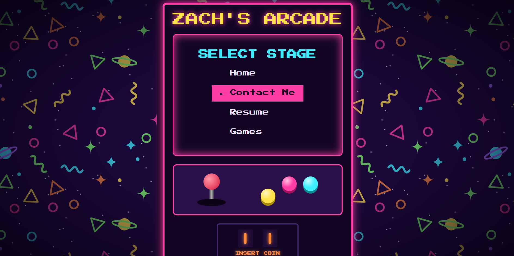
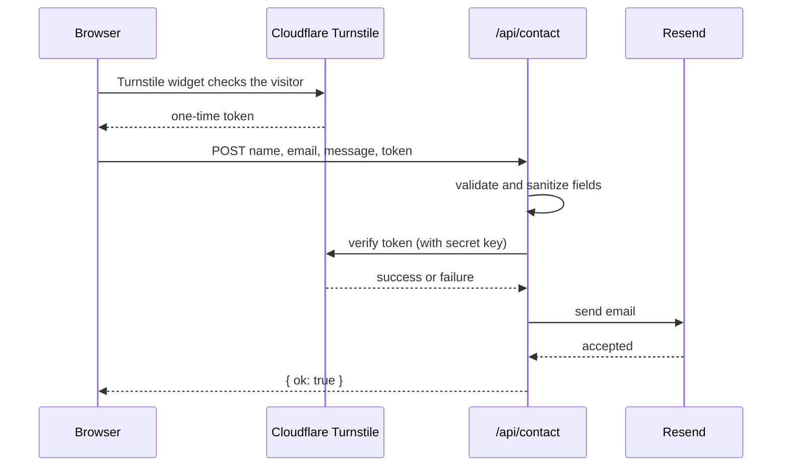

# Zach's Arcade

**Live site:** [zachs-arcade.vercel.app](https://zachs-arcade.vercel.app)

My personal portfolio, built as a '90s arcade cabinet. The home page is a cabinet select screen. Pick a stage with the arrow keys (the joystick tilts as you go) to read about me, view my résumé, send me a message, or play arcade games inspired by the classics.



## Features

- **Arcade select menu.** Arrow keys move the highlight, Enter selects and Escape returns to the menu. Mouse, touch and Tab navigation all work too, and keyboard focus and the highlight stay in sync.
- **Animated cabinet, built in CSS.** The marquee, CRT screen, a joystick that tilts with your keypresses, 3D arcade buttons, glowing coin slots and a tiling cosmic-carpet background. No images except the carpet tile.
- **Résumé screen**, rendered from typed data, with a PDF download.
- **Contact form with a real backend:** a serverless function that validates and sanitizes input, verifies a Cloudflare Turnstile token on the server, and emails the message to me through Resend.
- **Shareable URLs.** Each screen has its own address (`#/resume`, `#/contact`), so the back button, refreshing and direct links all work.

## Tech stack

| Layer | Tools |
| --- | --- |
| Frontend | React 19, TypeScript, Vite |
| Styling | Hand-written CSS with custom properties, no framework |
| Backend | Vercel Functions (TypeScript) |
| Email | Resend |
| Bot protection | Cloudflare Turnstile |
| Hosting | Vercel, deployed automatically on every push to `main` |
| Quality | ESLint, TypeScript strict mode |

## How the contact form works



Design decisions, and why:

- **The server validates everything, even though the form does too.** The browser's checks are a convenience for honest visitors. Anyone can call the endpoint directly, without the form. I tested the endpoint with `curl` against missing fields, wrong types, oversized values, invalid JSON, a `null` body and the wrong HTTP method, and each one gets a clean `400`, `403` or `405` instead of a crash.
- **Cheap checks run first.** Field validation happens before the captcha is verified, so malformed requests are rejected without a network call to Cloudflare.
- **The captcha is verified on the server.** A browser-only captcha can be skipped by a bot, but a token Cloudflare confirms can't be faked. The widget runs in `interaction-only` mode: it stays invisible unless Cloudflare decides a visitor needs to be challenged.
- **Input is sanitized before it reaches email headers.** Line breaks are stripped from the name and email to prevent header injection. Resend already guards against this, so this is defense in depth.
- **Secrets never reach the browser.** API keys live in Vercel environment variables, never in code or Git. Only values prefixed with `VITE_` are bundled into browser code, so the public Turnstile site key has that prefix and the secret key deliberately does not.
- **Separate keys per environment.** Local development uses Cloudflare's published test keys, and production uses the real ones, so local work never depends on the live widget.

## Project structure

```
api/
  contact.ts          Serverless contact endpoint
  tsconfig.json       Node-specific TypeScript settings for server code
public/
  carpet.svg          Seamless background tile
src/
  App.tsx             Hash-based routing and the global Escape key
  components/
    ScreenFrame.tsx   Shared cabinet frame for every content screen
  data/
    resume.ts         Résumé content as typed data
  screens/            Menu, Home, Games, Résumé, Contact
  index.css           All styles; colors defined once as CSS variables
```

## Running it locally

You need Node.js and the [Vercel CLI](https://vercel.com/docs/cli) (`npm install -g vercel`).

```bash
npm install
vercel link                  # connect the folder to the Vercel project
vercel env pull .env.local   # download development environment variables
vercel dev                   # runs the site and the /api functions together
```

Then open the address `vercel dev` prints (usually `http://localhost:3000`). Plain `npm run dev` serves the site without the API, so the contact form won't work there.

Environment variables:

| Name | Purpose |
| --- | --- |
| `RESEND_API_KEY` | Sends email (server only) |
| `CONTACT_TO_EMAIL` | Where contact messages are delivered |
| `TURNSTILE_SECRET_KEY` | Verifies captcha tokens (server only) |
| `VITE_TURNSTILE_SITE_KEY` | Public key that renders the Turnstile widget |

**On Windows:** the Vercel CLI needs to create symlinks, so turn on **Developer Mode** (Settings → System → For developers) or `vercel dev` fails with `EPERM` errors.

## Roadmap

- [ ] Eight original games inspired by arcade classics: snake, brick breaker, falling blocks, space rocks, a formation shooter, a lane crosser, a maze chase and a tunnel digger
- [ ] Local high scores per game
- [ ] A global leaderboard with three-letter arcade initials, backed by a database and an `/api/scores` endpoint
- [ ] An "insert coin" drag interaction on the contact form

## About the games

The games are original works inspired by classic arcade titles. Game mechanics aren't copyrightable, but names, characters and visual designs are, so each game has its own name, art and twist. Not affiliated with or endorsed by the owners of the original titles.

## Credits

- Fonts: [Press Start 2P](https://fonts.google.com/specimen/Press+Start+2P) and [VT323](https://fonts.google.com/specimen/VT323) via Google Fonts, under the SIL Open Font License.